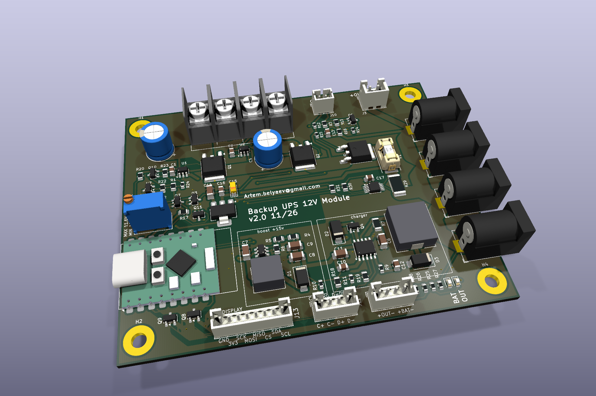

# Backup UPS 12V Module

English | [Русский](readme.ru.md)

No-break switchover between a 12 V PSU and a 3S2P battery, with load current up to 8 A. Board size,
mounting holes and connectors J1, J4, J6, J7, J8 match the Backup power switch 12v Module.

## Background

This board is the next step of the [Backup power switch 12v Module](https://github.com/abel-msk/Backup-power-switch-12v-Module) project (v5.0). It keeps the board outline and the main connectors, but the switchover and the charger were redesigned because of the limitations found in v5.0:

| | Backup power switch v5.0 | Why it was changed | This board |
|---|---|---|---|
| **Switchover** | Relay K1 controlled by ESP32-C3 firmware, diode-OR D7 holds the outputs while the relay moves | Backup depended on running firmware, and the relay is a mechanical part in the 12 V path | Two ideal diodes and no relay. The battery leg is enabled by hardware, without firmware |
| **Mains loss detection** | Firmware compares INA219 currents | The battery back-feeds the PSU side through D7 and K1, so the PSU voltage divider still reads close to normal | U1 blocks back-feed, and the U7 detector measures PSU_IN directly |
| **Charging** | CN3763 buck charger fed directly from the PSU | With a 12.6 V PSU the pack reaches only about 11.2–11.4 V (45–55 % capacity), DONE is never asserted and most BMS boards do not balance | MT3608 boosts the charger input to 14.7 V, so the pack can charge to 12.6 V |
| **Monitoring** | Two INA219 sensors and ADC dividers | No longer needed to detect mains loss | Mains loss is detected in hardware, without a sensor. U8 (INA226) on shunt R29 measures the output current and voltage for monitoring only. The ESP32-C3 also reads ON_BATTERY, CHRG_SIG and DONE_SIG |

This design has not been tested on hardware yet.

## How it works

- **PSU to output:** ideal diode U1 (LM74700-Q1) + Q1 (AOD514).
- **Battery to output:** U2 + Q2. While mains is present, Q3 holds the EN pin of U2 low, so the battery does not discharge.
- **Mains detector:** reference U7 (LMV431AIMF) and switch Q10 (AO3401A) drive the bases of Q3 and Q7. The threshold is set with RV1.
- **Mains lost:** current immediately flows through the body diode of Q2, then U2 turns Q2 on. The output does not drop out.
- **Charging:** the MT3608 boosts PSU_IN to 14.7 V, and the CN3763 charges the pack to 12.6 V at 0.8 A.
  Without the boost, a buck charger running from 12 V cannot fully charge a 3S pack (see the README of the old board).

## Switchover logic

The thresholds and timings below come from calculation and ngspice simulation. They have not been measured on hardware.

The power path is two ideal diodes feeding the common node VOR. The no-break behavior comes from the body diode of Q2: it is permanently connected from the battery to VOR and starts conducting on its own, with no control signal. The detector only decides when to turn Q2 fully on.

### How the detector works

U7 compares the voltage on REF with its internal 1.24 V reference. REF receives a fraction of PSU_IN through the divider R20 + RV1 (upper leg) and R21 (lower leg).

| PSU_IN | U7 | Q10 | Q3 and Q7 | BAT_EN (U2 EN input) | Q2 | ON_BATTERY |
|---|---|---|---|---|---|---|
| above threshold | conducting | on | on | about 0 V | off, only the body diode conducts | 0 |
| below threshold | off | off | off | pulled up through R3 from SW_ON | on | 1 |

When PSU_IN is above the threshold, U7 pulls the gate of Q10 down through R24. Q10 turns on and feeds the bases of Q3 and Q7 through R1. When PSU_IN is below the threshold, R23 turns Q10 off and R2 discharges the bases.

### Why there are two thresholds

Without hysteresis, the detector would chatter around the threshold because of ripple on PSU_IN. The hysteresis comes from R22 (10 MΩ) between the drain of Q10 and REF:

- **Q10 on (mains present):** R22 is in parallel with the upper leg and raises REF slightly. PSU_IN has to fall further before U7 turns off. This is the battery enable threshold: `1.24 × (1 + (R20 + RV1) ∥ R22 / R21)`.
- **Q10 off (running on battery):** R22, through R1, loads the lower leg and lowers REF slightly. PSU_IN has to rise further before U7 turns on. This is the battery disable threshold: `1.24 × (1 + (R20 + RV1) / (R21 ∥ (R22 + R1)))`.

Temperature from 0 to 60 °C shifts the threshold by about ±0.02 V, because the threshold is set by the U7 reference and not by a transistor base-emitter voltage.

| RV1 | Battery enabled when PSU_IN falls below | Battery disabled when PSU_IN rises above |
|---|---|---|
| 0 Ω | 10.96 V | 11.15 V |
| 5 kΩ | 11.26 V | 11.46 V |
| 10 kΩ | 11.56 V | 11.77 V |

With tolerances (Vref ±1%, R20 and R21 ±1%, RV1 ±10%, others ±5%, 0–60 °C):

| RV1 | Battery enable | Battery disable |
|---|---|---|
| 0 Ω | 10.72–11.18 V | 10.92–11.38 V |
| 10 kΩ | 11.31–11.87 V | 11.52–12.09 V |

Hysteresis is 0.18–0.23 V. Turning RV1 clockwise raises the threshold (per the Bourns 3296 datasheet; confirm on the Baoter part with a continuity check).

### Mains lost

1. PSU_IN falls and VOR falls with it. C5 supplies part of the current.
2. As soon as VOR is above PSU_IN, U1 turns Q1 off. The battery does not back-feed the PSU or the MT3608.
3. When VOR drops about 0.8 V below the pack voltage, the body diode of Q2 starts conducting. From this point the battery supplies the load.
4. PSU_IN crosses the battery enable threshold. U7, Q10, Q3 and Q7 turn off.
5. About 60–80 µs after the threshold crossing, BAT_EN rises through R3. U2 turns Q2 on, and the drop falls from 0.8 V to a fraction of a volt.
6. ON_BATTERY goes to 1, and D4 and the external BAT LED on J12 light up.

The duration of steps 3–5 depends on how fast PSU_IN decays. If the pack is discharged so far that its voltage minus 0.8 V is below the threshold, the detector acts before the diode conducts and this phase does not occur.

### Mains restored

1. PSU_IN rises and crosses the battery disable threshold. U7 and Q10 turn on, Q3 pulls BAT_EN to ground in about 9 µs, and Q2 turns off. The load stays on the body diode of Q2.
2. When PSU_IN exceeds VOR, U1 turns Q1 on and the load moves to mains with no break.
3. ON_BATTERY returns to 0, and the CN3763 charges the pack again.

### Short dips

C3 and R2, together with the switching delay, reject short disturbances. The detector ignores a PSU_IN dip from 12.6 to 9 V lasting up to 50 µs, and a dip of 100 µs or longer enables the battery. When that happens the battery simply picks up the load.

### Output switch

The BAT_EN pull-up comes from SW_ON, so with J10 open U2 stays disabled regardless of the detector. Q5 then disconnects the output, and the ESP32 and the indicators turn off along with VOUT.

### Limitations

- **Sustained PSU sag.** If PSU_IN stays between the threshold and the pack voltage minus 0.8 V (full pack: from the threshold up to 11.8 V), the battery is not yet enabled, but current flows through the body diode of Q2. That is about 6.4 W at 8 A, so this state must not be sustained.
- **PSU voltage.** The battery disable threshold must be at least 0.3 V below PSU_IN under load. Do not use the top position of RV1 with a 12.0 V PSU.
- **Full pack with a 12.0 V PSU.** The body diode of Q2 is close to conducting, so the battery can discharge slightly. Set the PSU to 12.3–12.6 V.

## Schematic sheets

| Sheet | File | Contents | Connections to root |
|---|---|---|---|
| Root | `Backup UPS 12v Module.kicad_sch` | ideal diodes, output switch, ESP32, status transistors Q8 and Q9, indicators, J11 and J12 | |
| Boost | `boost.kicad_sch` | MT3608 (U3) and its components | PSU_IN, V15 |
| Charger | `charger.kicad_sch` | CN3763 (U4) and its components | V15, BAT+, CHRG, DONE |
| Detector | `detector.kicad_sch` | mains detector: threshold (U7, RV1, R20–R22), Q10, Q3, Q7 | PSU_IN, SW_ON, 3V3, BAT_EN, ON_BATTERY |

## ESP32-C3 Pro Mini

3.3 V comes from an AMS1117-3.3 (U6) fed by VOUT, so the ESP turns off when the output is switched off.

| GPIO | Signal | Meaning |
|---|---|---|
| GPIO4 | ON_BATTERY | 1 on battery, 0 on mains. Interrupt on both edges = switchover moment |
| GPIO3 | CHRG_SIG | 1 charging. Enable the internal pull-up |
| GPIO7 | DONE_SIG | 1 charge complete. Enable the internal pull-up |
| GPIO8 | SDA | I2C data to INA226 (U8, address 0x40), 10 kΩ pull-up on the board |
| GPIO9 | SCL | I2C clock to INA226 |

CHRG_SIG and DONE_SIG pass through 2N7002 transistors (Q8, Q9), so the logic is inverted. If V15 is present but the CN3763 is not charging, both signals read 0. Without mains both read 1, so check ON_BATTERY first. U6 dissipates about 0.9 W at 100 mA with 12.6 V input.

Charge status LEDs connect to J11 (JST PH, 4 pins): 1 CHRG anode, 2 CHRG cathode,
3 DONE anode, 4 DONE cathode. The current-limiting resistors are on the board.

Load power indicator: green D5 from VOUT through R27 3 kΩ, lit when voltage is present on the output (marked OUT). A matching external LED connects to J12 (JST PH, 4 pins): pin 1 anode, pin 2 cathode, through R28 3 kΩ from VOUT.

Battery operation indicator: D4 on the board and an external LED on J12 (pin 3 anode, pin 4 cathode). Both light when ON_BATTERY = 1, through switch Q11 (2N7002), powered from VOUT through R25 and R26 at 3 kΩ each, about 3 mA per LED. The indicator does not work when the output is off. Board markings: J11 C+ C- D+ D- (C = CHRG, D = DONE), J12 left to right +OUT- and +BAT-.

Output monitor: U8 (INA226) measures the output current on shunt R29 (2 mΩ, 2512) and the output voltage after the shunt. At 8 A the shunt drops 16 mV and dissipates 0.13 W. The ESP32 and U6 are fed before the shunt, so their current is not counted. ALERT is not connected.

Display connector J13 with SPI and I2C (JST PH, 8 pins):

| Pin | Signal | ESP32 |
|---|---|---|
| 1 | GND | |
| 2 | 3V3 | from U6 |
| 3 | SCK | GPIO6 |
| 4 | MOSI | GPIO10 |
| 5 | MISO | GPIO21 |
| 6 | CS | GPIO1 |
| 7 | SDA | GPIO8 |
| 8 | SCL | GPIO9 |

## Output off

An external switch connects to J10 (JST PH, 2 pins, no polarity).
Closed: output on. Open or not connected: output off.

- Q5 (AOD403) breaks the positive output line, and R16 discharges the output when there is no load.
- With no mains and the output off, the battery typically supplies about 11 µA to the board, about 17 µA maximum (CN3763 9–15 µA, U2 in shutdown up to 1.5 µA).
- With mains present, the battery keeps charging even when the output is off.
- F1 (1808 fuse, 10 A, in a 01550900M style SMD holder) sits between Q5 and VOUT. At 8 A continuous it runs at 80% of its rating, so a hot board can blow it early. Do not fit a fuse above 10 A: the original holder is rated for 10 A.
- J3 (JST XH) is limited to 3 A. The main 8 A current flows through power connectors J4, J6, J7, J8.

## Requirements

- PSU 12–12.6 V, at least 10 A (8 A load + about 1.1 A charger). PSU_IN under load must stay above the battery disable threshold, otherwise the board switches to battery.
- 3S BMS rated for at least 15 A continuous. Discharge cutoff is handled only by the BMS.
- On battery, the output equals the pack voltage minus about 0.1 V: from 12.6 V down to about 9 V.
- Routing (IPC-2221, 35 µm copper, up to 20 °C rise): PSU_IN and GNDPWR 4.5 mm, VOUT, VOR and BAT+ 4.0 mm,
  charger nets 0.8 mm, signal nets 0.2 mm. GNDPWR is best as a polygon. Widths are set in the project net classes.
- Vias 0.6 / 0.3 mm, each carries about 1.9 A: use at least 5 on a power net, preferably 8.
