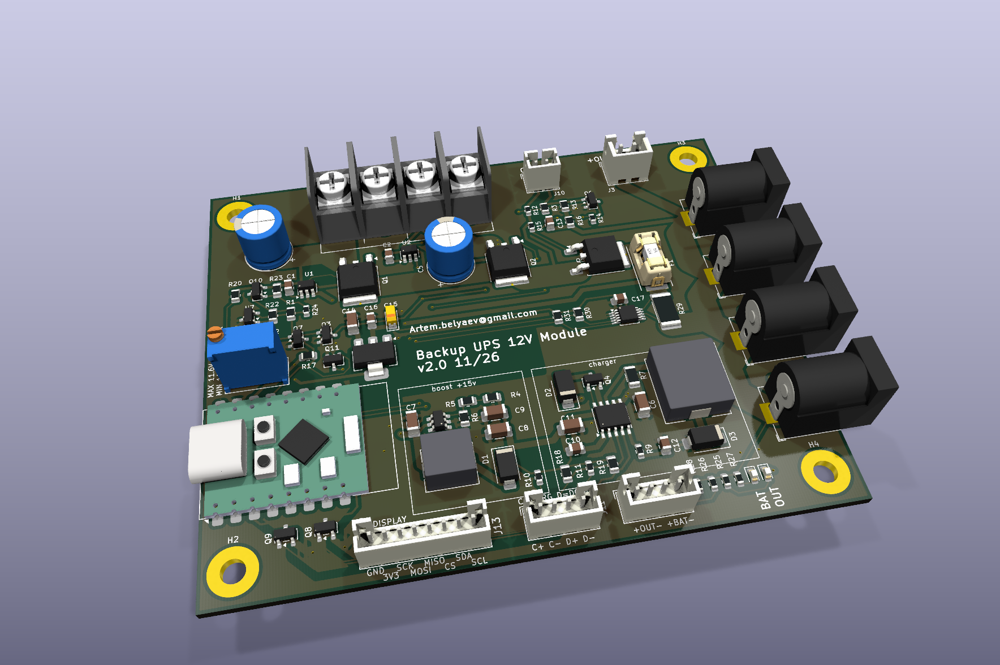

# Backup UPS 12V Module

[English](README.md) | Русский

Переключение 12 В PSU / батарея 3S2P без разрыва, ток нагрузки до 8 А. Размер платы,
крепёжные отверстия и разъёмы J1, J4, J6, J7, J8 совпадают с Backup power switch 12v Module.

## Предыстория

Эта плата продолжает проект [Backup power switch 12v Module](https://github.com/abel-msk/Backup-power-switch-12v-Module) (v5.0). Контур платы и основные разъёмы сохранены, но переключение и зарядка переработаны из-за ограничений, выявленных в v5.0:

| | Backup power switch v5.0 | Почему изменено | Эта плата |
|---|---|---|---|
| **Переключение** | Реле K1 под управлением прошивки ESP32-C3, диодное ИЛИ D7 держит выходы на время срабатывания реле | Резервирование зависело от работающей прошивки, а реле является механической деталью в цепи 12 В | Два идеальных диода, реле нет. Батарейное плечо включается аппаратно, без прошивки |
| **Определение пропадания сети** | Прошивка сравнивает токи INA219 | Батарея подпитывает сторону PSU через D7 и K1, поэтому делитель напряжения PSU показывает почти норму | U1 блокирует обратный ток, а детектор U7 измеряет PSU_IN напрямую |
| **Заряд** | Понижающий зарядник CN3763 напрямую от блока питания | С блоком питания 12,6 В пакет заряжается только до 11,2–11,4 В (45–55 % ёмкости), DONE не выставляется, большинство BMS не балансирует | MT3608 поднимает вход зарядника до 14,7 В, поэтому пакет может заряжаться до 12,6 В |
| **Мониторинг** | Два датчика INA219 и делители для АЦП | Для определения пропадания сети больше не нужны | ESP32-C3 читает только ON_BATTERY, CHRG_SIG и DONE_SIG. Ток и напряжение не измеряются |

На реальном железе эта схема пока не проверялась.

## Как работает

- **PSU → выход:** идеальный диод U1 (LM74700-Q1) + Q1 (AOD514).
- **Батарея → выход:** U2 + Q2. Пока есть сеть, Q3 держит EN у U2 в нуле, и батарея не разряжается.
- **Детектор сети:** опорник U7 (LMV431AIMF) и ключ Q10 (AO3401A) подают ток на базы Q3 и Q7. Порог настраивается RV1.
- **Пропала сеть:** ток сразу идёт через внутренний диод Q2, затем U2 включает Q2. Выход не пропадает.
- **Заряд:** MT3608 поднимает PSU_IN до 14,7 В, CN3763 заряжает пакет до 12,6 В током 0,8 А.
  Без подъёма buck-зарядник от 12 В не дозаряжает 3S (см. README старой платы).

## Логика переключения

Значения порогов и времён ниже получены расчётом и симуляцией в ngspice. На макете они не измерялись.

Силовая часть состоит из двух идеальных диодов на общий узел VOR. Выход без разрыва обеспечивает внутренний диод Q2: он подключён от батареи к VOR постоянно и начинает проводить сам, без управления. Детектор только решает, когда открыть Q2 полностью.

### Как работает детектор

U7 сравнивает напряжение на REF с внутренней опорой 1,24 В. На REF приходит часть PSU_IN через делитель R20 + RV1 (верхнее плечо) и R21 (нижнее плечо).

| PSU_IN | U7 | Q10 | Q3 и Q7 | BAT_EN (вход EN у U2) | Q2 | ON_BATTERY |
|---|---|---|---|---|---|---|
| выше порога | проводит | открыт | открыты | около 0 В | закрыт, проводит только диод | 0 |
| ниже порога | закрыт | закрыт | закрыты | поднят через R3 от SW_ON | открыт | 1 |

Когда PSU_IN выше порога, U7 тянет затвор Q10 вниз через R24. Q10 открывается и через R1 подаёт ток на базы Q3 и Q7. Когда PSU_IN ниже порога, R23 закрывает Q10, а R2 разряжает базы.

### Почему порога два

Без гистерезиса детектор дребезжал бы около порога при пульсациях PSU_IN. Гистерезис создаёт R22 (10 МОм) между стоком Q10 и REF:

- **Q10 открыт (сеть есть):** R22 подключён параллельно верхнему плечу и немного поднимает REF. Чтобы U7 закрылся, PSU_IN должен упасть ниже. Это порог включения батареи: `1,24 × (1 + (R20 + RV1) ∥ R22 / R21)`.
- **Q10 закрыт (работа от батареи):** R22 через R1 подключён к нижнему плечу и немного опускает REF. Чтобы U7 открылся, PSU_IN должен подняться выше. Это порог отключения батареи: `1,24 × (1 + (R20 + RV1) / (R21 ∥ (R22 + R1)))`.

Температура от 0 до 60 °C сдвигает порог примерно на ±0,02 В, потому что порог задаёт опорник U7, а не напряжение база-эмиттер транзистора.

| RV1 | Батарея включается при падении PSU_IN ниже | Батарея отключается при росте PSU_IN выше |
|---|---|---|
| 0 Ом | 10,96 В | 11,15 В |
| 5 кОм | 11,26 В | 11,46 В |
| 10 кОм | 11,56 В | 11,77 В |

С учётом допусков (Vref ±1%, R20 и R21 ±1%, RV1 ±10%, остальные ±5%, 0–60 °C):

| RV1 | Включение батареи | Отключение батареи |
|---|---|---|
| 0 Ом | 10,72–11,18 В | 10,92–11,38 В |
| 10 кОм | 11,31–11,87 В | 11,52–12,09 В |

Гистерезис 0,18–0,23 В. Вращение RV1 по часовой стрелке поднимает порог (по даташиту Bourns 3296, для Baoter подтвердить прозвонкой).

### Пропала сеть

1. PSU_IN падает, VOR падает вместе с ним. Часть тока отдаёт C5.
2. Как только VOR становится выше PSU_IN, U1 закрывает Q1. Батарея не уходит обратно в блок питания и в MT3608.
3. Когда VOR опускается примерно на 0,8 В ниже напряжения пакета, начинает проводить внутренний диод Q2. С этого момента нагрузку питает батарея.
4. PSU_IN проходит порог включения батареи. U7 закрывается, Q10 закрывается, Q3 и Q7 закрываются.
5. Примерно через 60–80 мкс после прохождения порога BAT_EN поднимается через R3. U2 открывает Q2, и падение уменьшается с 0,8 В до долей вольта.
6. ON_BATTERY становится 1, зажигаются D4 и внешний светодиод BAT на J12.

Длительность шагов 3–5 зависит от скорости спада PSU_IN. Если пакет разряжен так, что его напряжение минус 0,8 В ниже порога, детектор сработает раньше диода, и этой фазы не будет.

### Сеть вернулась

1. PSU_IN растёт и проходит порог отключения батареи. U7 и Q10 открываются, Q3 примерно за 9 мкс прижимает BAT_EN к земле, Q2 закрывается. Нагрузка остаётся на диоде Q2.
2. Когда PSU_IN превышает VOR, U1 открывает Q1, и нагрузка переходит на сеть без разрыва.
3. ON_BATTERY возвращается в 0, CN3763 снова заряжает пакет.

### Короткие провалы

C3 и R2 вместе с задержкой ключей отфильтровывают короткие помехи. Провал PSU_IN с 12,6 до 9 В длиной до 50 мкс детектор игнорирует, провал от 100 мкс включает батарею. При включении батарея просто подхватывает нагрузку.

### Выключатель

Подтяжка BAT_EN идёт от SW_ON, поэтому при разомкнутом J10 U2 остаётся выключенным независимо от детектора. Q5 при этом отключает выход, а ESP32 и индикаторы гаснут вместе с VOUT.

### Ограничения

- **Длительная просадка PSU.** Если PSU_IN держится между порогом и напряжением пакета минус 0,8 В (полный пакет: от порога до 11,8 В), батарея ещё не включена, но ток идёт через диод Q2. Это около 6,4 Вт при 8 А, такой режим не должен быть длительным.
- **Напряжение блока питания.** Порог отключения батареи должен быть ниже PSU_IN под нагрузкой хотя бы на 0,3 В. Верхнее положение RV1 нельзя использовать с блоком питания на 12,0 В.
- **Полный пакет и PSU 12,0 В.** Диод Q2 близок к порогу проводимости, поэтому батарея может понемногу разряжаться. Блок питания лучше выставить на 12,3–12,6 В.

## Листы схемы

| Лист | Файл | Содержимое | Связи с корневым листом |
|---|---|---|---|
| Корневой | `Backup UPS 12v Module.kicad_sch` | идеальные диоды, выключатель, ESP32, транзисторы статуса Q8 и Q9, индикаторы, J11 и J12 | |
| Boost | `boost.kicad_sch` | MT3608 (U3) с обвязкой | PSU_IN, V15 |
| Charger | `charger.kicad_sch` | CN3763 (U4) с обвязкой | V15, BAT+, CHRG, DONE |
| Detector | `detector.kicad_sch` | детектор сети: порог (U7, RV1, R20–R22), Q10, Q3, Q7 | PSU_IN, SW_ON, 3V3, BAT_EN, ON_BATTERY |

## ESP32-C3 Pro Mini

Питание 3,3 В от AMS1117-3.3 (U6) с выхода VOUT, поэтому при выключении выхода ESP выключается тоже.

| GPIO | Сигнал | Значение |
|---|---|---|
| GPIO4 | ON_BATTERY | 1 работа от батареи, 0 от сети. Прерывание на оба фронта = момент переключения |
| GPIO3 | CHRG_SIG | 1 идёт заряд. Включить внутренний pull-up |
| GPIO7 | DONE_SIG | 1 заряд окончен. Включить внутренний pull-up |
| GPIO8 | SDA | данные I2C к INA226 (U8, адрес 0x40), подтяжка 10 кОм на плате |
| GPIO9 | SCL | тактирование I2C к INA226 |

CHRG_SIG и DONE_SIG идут через 2N7002 (Q8, Q9), логика инвертирована. Если V15 есть, а CN3763 не заряжает, оба сигнала 0. Без сети оба читаются как 1, поэтому сначала проверяйте ON_BATTERY. U6 рассеивает около 0,9 Вт при 100 мА и 12,6 В на входе.

Светодиоды статуса заряда подключаются к J11 (JST PH, 4 контакта): 1 анод CHRG, 2 катод CHRG,
3 анод DONE, 4 катод DONE. Токоограничивающие резисторы стоят на плате.

Индикатор питания нагрузки: зелёный D5 от VOUT через R27 3 кОм, горит при поданном на выход напряжении (подпись OUT). Такой же внешний светодиод подключается к J12 (JST PH, 4 контакта): контакт 1 анод, контакт 2 катод, через R28 3 кОм от VOUT.

Индикатор работы от батареи: D4 на плате и внешний светодиод на J12 (контакт 3 анод, контакт 4 катод). Оба зажигаются, когда ON_BATTERY = 1, через ключ Q11 (2N7002), питание от VOUT через R25 и R26 по 3 кОм, около 3 мА на светодиод. При выключенном выходе индикатор не работает. На плате контакты подписаны: J11 C+ C- D+ D- (C = CHRG, D = DONE), J12 слева направо +OUT- и +BAT-.

Монитор выхода: U8 (INA226) измеряет ток выхода на шунте R29 (2 мОм, 2512) и напряжение после шунта. При 8 А падение на шунте 16 мВ, мощность 0,13 Вт. ESP32 и U6 подключены до шунта, поэтому их ток не учитывается. ALERT не подключён.

Разъём дисплея J13 с SPI и I2C (JST PH, 8 контактов):

| Контакт | Сигнал | ESP32 |
|---|---|---|
| 1 | GND | |
| 2 | 3V3 | от U6 |
| 3 | SCK | GPIO6 |
| 4 | MOSI | GPIO10 |
| 5 | MISO | GPIO21 |
| 6 | CS | GPIO1 |
| 7 | SDA | GPIO8 |
| 8 | SCL | GPIO9 |

## Выключение

Внешний выключатель подключается к J10 (JST PH, 2 контакта, без полярности).
Замкнут: выход включён. Разомкнут или не подключён: выход выключен.

- Q5 (AOD403) разрывает плюс выхода, R16 разряжает выход без нагрузки.
- Без сети батарея в выключенном состоянии отдаёт на плату обычно около 11 мкА, максимум около 17 мкА (CN3763 9–15 мкА, U2 в shutdown до 1,5 мкА).
- При наличии сети заряд батареи продолжается и при выключенном выходе.
- F1 (предохранитель 1808 на 10 А в SMD-держателе типа 01550900M) стоит между Q5 и VOUT. При длительных 8 А он работает на 80% номинала, поэтому на горячей плате возможно преждевременное срабатывание. Предохранитель больше 10 А ставить нельзя: оригинальный держатель рассчитан на 10 А.
- J3 (JST XH) не более 3 А. Основной ток 8 А идёт через разъёмы питания J4, J6, J7, J8.

## Условия

- Блок питания 12–12,6 В, не менее 10 А (8 А нагрузка + ~1,1 А зарядник). Напряжение на PSU_IN под нагрузкой должно быть выше порога отключения батареи, иначе плата уйдёт на батарею.
- BMS 3S на длительный ток не менее 15 А. Отсечка разряда только в BMS.
- На батарее выход равен напряжению пакета минус ~0,1 В: от 12,6 В до примерно 9 В.
- Разводка (IPC-2221, медь 35 мкм, нагрев до 20 °C): PSU_IN и GNDPWR 4,5 мм, VOUT, VOR и BAT+ 4,0 мм,
  цепи зарядника 0,8 мм, сигнальные 0,2 мм. GNDPWR лучше полигоном. Ширина задана в классах цепей проекта.
- Переходные отверстия 0,6 / 0,3 мм, одно держит около 1,9 А: на силовую цепь не меньше 5, лучше 8.
